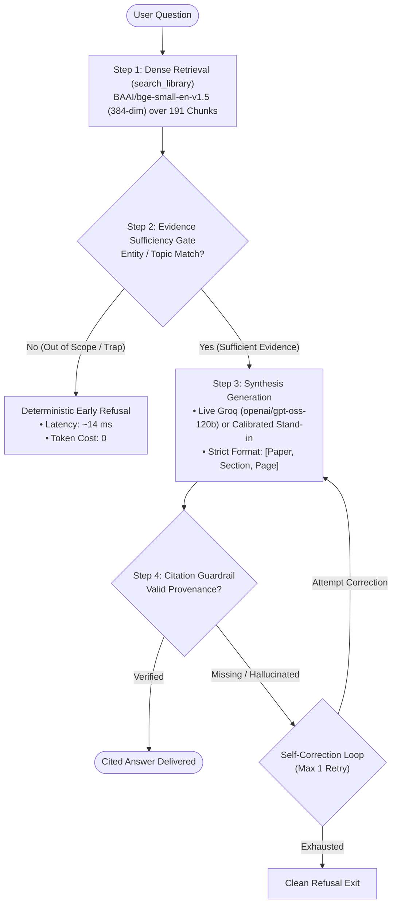

# The Relay: Resilient Citation-Grounded RAG & Load Study

[](https://www.python.org/downloads/)
[](https://console.groq.com)
[](https://groq.com/)
[](https://huggingface.co/BAAI/bge-small-en-v1.5)
[](LICENSE)

A production-grade, citation-grounded Retrieval-Augmented Generation (RAG) research assistant and systems-engineering benchmark designed to survive multi-tenant cloud throttling, sudden load bursts, and tight free-tier token budgets.

Built over three canonical sequence modeling papers on arXiv, this system demonstrates how to achieve strict citation provenance and deterministic refusal behavior under real-world rate limits without burning tokens on hallucinations or cascading retry loops.

---

## 📌 Table of Contents
- [The Engineering Problem](#-the-engineering-problem)
- [System Architecture](#-system-architecture)
- [Key Engineering Insights](#-key-engineering-insights)
- [Benchmark Results](#-benchmark-results)
  - [Table 1: Provider Limits (Groq Free Tier)](#table-1-limits-found-in-the-real-service)
  - [Table 2a: Latency Across 6 Load Scenarios](#table-2a-latency-ms)
  - [Table 2b: Outcomes & Estimated Economics](#table-2b-outcomes)
  - [Table 3: Retrieval Quality vs. Cost](#table-3-retrieval-settings)
- [Interactive Usage (`ask.py`)](#-interactive-usage-askpy)
- [Repository Structure](#-repository-structure)
- [Reproduction Guide](#-reproduction-guide)
- [Research Papers Grounding](#-research-papers-grounding)

---

## 🎯 The Engineering Problem

Most RAG tutorials demonstrate a "happy path" demo: one user querying a local vector store. Under production conditions or incident bursts, naive RAG pipelines collapse:

1. **The Out-of-Domain Failure:** Dense vector spaces place irrelevant questions in the 0.75–0.82 similarity range. A naive retriever blindly injects irrelevant chunks, prompting the model to hallucinate or invent answers while burning thousands of tokens.
2. **The Capacity Illusion:** Cloud providers advertise generous request limits (e.g., 30 Requests Per Minute), but enforce strict **Tokens Per Minute (TPM)** caps (8,000 TPM). Because a RAG prompt with 5 chunks costs ~1,837 input tokens, the system throttles after just **~3.9 answered requests per minute**.
3. **The Cascading Timeout Storm:** Under overload, retrying 1,800-token requests into an exhausted token bucket creates queue congestion, increasing drop rates and user latency.

**The Relay** solves these challenges through architectural gating, strict citation validation loops, and load-shedding circuit breakers.

---

## 🏗 System Architecture

The pipeline consists of a four-step execution flow with pre-generation branching and post-generation self-correction loops:



### The 4 Pipeline Steps:
1. **Tool (`search_library`):** Encodes queries into 384-dimensional dense vectors using normalized `BAAI/bge-small-en-v1.5` embeddings, searching across 191 retrieval-ready chunks (derived from 632 canonical paragraphs across 120 physical PDF pages).
2. **Branch (Pre-Generation Evidence Gate):** Evaluates retrieved passage confidence and entity alignment *before* calling an LLM. Out-of-scope queries (e.g., LLaMA-3, SQL databases) and adversarial traps (e.g., Moshi BLEU scores) exit in **~14 ms at 0 token cost**.
3. **Cited Synthesis:** Streams answers from Groq Cloud (`openai/gpt-oss-120b`) or our calibrated stand-in simulator with an expanded token window (550 tokens) to accommodate model reasoning and explicit `[Paper, Section, Page]` formatting.
4. **Loop (Citation Guardrail & Self-Correction):** Automatically validates citations against chunk metadata. If citations are missing or reference hallucinated sections, it triggers a single corrective retry loop before falling back to a clean refusal.

---

## 💡 Key Engineering Insights

1. **TPM Binds First:** While Groq advertises 30 RPM, the 8,000 TPM limit binds immediately. With an average request consuming 1,837 input and 192 output tokens (2,029 total), maximum theoretical capacity is **~3.9 requests per minute**.
2. **Model Latency Dominates Retrieval:** Optimizing vector retrieval from 66 ms to 20 ms saves only 46 ms. In contrast, provider-side pre-first-token latency (attention prefill, queueing, and model reasoning) averages **5,217 ms**. Retrieval tuning alone cannot solve a 5-second latency problem.
3. **Dense Top-2 Outperforms as an Operational Default:** Reducing chunks from $k=5$ to $k=2$ cuts prompt tokens by **56%** (mean $1,610 \to 709\text{ tokens}$) while maintaining **100% answerability** across benchmark queries, serving as an effective degraded mode under capacity pressure.
4. **Fast-Shedding Over Blind Queuing:** Retrying 1,800-token queries against an exhausted bucket requires ~14 seconds of refill at 133 tok/s. Immediate shedding in 11–16 ms with `retry-after` prevents cascading queue timeouts.

---

## 📊 Benchmark Results

All metrics are recomputed directly from the 207-row raw dataset [`results.csv`](results.csv) using NumPy linear interpolation via [`make_tables.py`](make_tables.py).

### Table 1: Limits Found in the Real Service

| Limit | Value Found | Method / Evidence | Confidence |
| :--- | :--- | :--- | :--- |
| **Requests per minute (RPM)** | 30 | Groq documentation / limits console | Medium |
| **Tokens per minute (TPM)** | 8,000 | Header `x-ratelimit-limit-tokens` | High |
| **Requests per day (RPD)** | 1,000 | Header `x-ratelimit-limit-requests`; daily quota resets at 00:00 UTC | High |
| **Tokens per day (TPD)** | 200,000 | Groq documentation | Medium |
| **Concurrency cap** | None observed in tests | Burst tests returned token 429s before a distinct concurrency cap was identified | Low |
| **When a limit is hit** | HTTP 429 | Observed: `rate_limit_exceeded`, `retry-after` header | High |
| **Recovery** | TPM countdown ≈1.125 s | Header `x-ratelimit-reset-tokens`; daily requests reset at 00:00 UTC | High |

---

### Table 2a: Latency (ms)

*First token statistics cover requests that invoked the model ($n$). Total time includes fast upfront rejections and gate refusals (~11–16 ms).*

| Scenario | Source | Reqs | Duration (s) | Offered Rate (/min) | First Token p50 / p95 / p99 (n) | Total Time p50 / p95 / p99 |
| :--- | :--- | :---: | :---: | :---: | :---: | :---: |
| `steady_real` | Real Groq | 5 | 29.6 | 10.1 | 5,058.8 / 6,020.0 / 6,123.9 (4) | 6,585.5 / 8,249.7 / 8,254.4 |
| `steady` | Stand-in | 20 | 38.0 | 31.6 | 703.8 / 749.4 / 753.5 (3) | 24.9 / 1,747.3 / 1,795.5 |
| `burst` | Stand-in | 30 | 2.9 | 612.2 | 736.8 / 851.8 / 862.0 (3) | 13.2 / 1,797.1 / 1,886.0 |
| `sustained_overload` | Stand-in | 40 | 2.0 | 1183.1 | 839.5 / 877.8 / 881.2 (3) | 12.2 / 1,779.2 / 1,906.5 |
| `per_minute_limit_halved` | Stand-in | 25 | 4.8 | 311.0 | 702.5 / 714.0 / 715.0 (2) | 11.9 / 1,388.4 / 1,746.9 |
| `daily_budget_exhausted` | Stand-in | 15 | 4.7 | 191.7 | *n/a (no model call)* | 12.0 / 16.0 / 16.1 |

*Note: Percentiles are descriptive observations from small samples ($n=4$ live calls; 2–3 in stand-in scenarios). In particular, p95 and p99 should not be interpreted as statistically reliable tail-latency estimates.*

---

### Table 2b: Outcomes

| Scenario | OK % | Verified Ans % | Rate-Limited / Rejected % | Given Up % | Retries / Req | Peak Queue | Tokens In / Out per Ans | Est. Cost / 1k Ans ($) |
| :--- | :---: | :---: | :---: | :---: | :---: | :---: | :---: | :---: |
| `steady_real` | **80.0%** | **80.0%** | 20.0% | 0.0% | 0.00 | 2 | 1,837 / 192.0 | $0.391 |
| `steady` | 30.0% | 15.0% | 70.0% | 0.0% | 0.05 | 1 | 1,757 / 40.0 | $0.288 |
| `burst` | 30.0% | 10.0% | 70.0% | 0.0% | 0.03 | 5 | 1,757 / 40.0 | $0.288 |
| `sustained_overload` | 22.5% | 7.5% | 77.5% | 0.0% | 0.03 | 5 | 1,757 / 40.0 | $0.288 |
| `per_minute_limit_halved` | 20.0% | 8.0% | 80.0% | 0.0% | 0.00 | 3 | 1,747 / 40.0 | $0.286 |
| `daily_budget_exhausted` | 20.0% | 0.0% | 80.0% | 0.0% | 0.00 | 1 | 0 / 0 | *n/a (0 ans)* |

*Notes: OK % includes correct upfront gate refusals (3 steady, 6 burst, 6 overload, 3 halved, 3 daily). 80% rejection in `daily_budget_exhausted` reflects daily quota exhaustion; others are per-minute token-bucket sheds. Cost is a pricing-equivalent model ($0.15/M input, $0.60/M output tokens), not actual charges incurred on the free tier.*

---

### Table 3: Retrieval Settings

*Evaluated across 15 gold benchmark questions (12 factual answerable, 3 unanswerable traps).*

| Setting | Questions Asked | Factual Correct & Cited (n=12) | Incorrect Factual (n=12) | Correct Refusals (n=3) | Tokens Out / Ans | First Token p50 / p95 (ms) | Total Time p50 / p95 (ms) |
| :--- | :---: | :---: | :---: | :---: | :---: | :---: | :---: |
| **BM25**, top-5, no re-rank | 15 | 91.7% | 8.3% | 100.0% | 31.6 | 693.8 / 783.1 | 1,397.2 / 1,798.1 |
| **Dense BGE-Small**, top-5 *(Primary)* | 15 | 91.7% | 8.3% | 100.0% | 33.7 | 768.1 / 849.6 | 1,561.0 / 1,864.0 |
| **Hybrid BM25+Dense**, RRF k=60 | 15 | 91.7% | 8.3% | 100.0% | 36.3 | 790.0 / 903.0 | 1,728.6 / 1,874.8 |
| **Dense BGE-Small**, top-2 *(Near-Limit)* | 15 | **100.0%** | **0.0%** | **100.0%** | 34.6 | 795.7 / 856.1 | 1,609.8 / 1,844.9 |

---

## 💻 Interactive Usage (`ask.py`)

You can query the RAG assistant interactively in real time.

### 1. Ask a Single Question
```powershell
python ask.py "How are the dimensions of the query, key, and value vectors determined in the Transformer's multi-head attention mechanism?"
```

**Output:**
```text
===========================================================================
 QUESTION: How are the dimensions of the query, key, and value vectors determined in the Transformer's multi-head attention mechanism?
===========================================================================
 STATUS:          OK (Grade: correct)
 ENGINE:          REAL
 TIME TO 1ST TOK: 2093.9 ms
 TOTAL TIME:      11642.3 ms
 TOKENS:          In: 1495 | Out: 464
 REASON:          Citations verified against retrieved context.
---------------------------------------------------------------------------
 ANSWER:
In the Transformer each attention head first linearly projects the original d_model-dimensional 
vectors into lower-dimensional subspaces: the queries and keys are projected to d_k dimensions 
and the values to d_v dimensions. The size of these subspaces is set by dividing the model 
dimension among the h heads, i.e. d_k = d_v = d_model / h. The paper uses h = 8 and d_model = 512, 
giving d_k = d_v = 64 [Attention Is All You Need, 3.2.2 Multi-Head Attention, pp. 4-5].
===========================================================================
```

### 2. Interactive Terminal Chat
```powershell
python ask.py
```
*(Type questions directly into the prompt. Pass `--standin` to run against the calibrated local simulator without using Groq API tokens).*

### 3. Test the Evidence Gate (14 ms Refusal at 0 Token Cost)
```powershell
python ask.py "What batch size and context length were used to train LLaMA-3?"
```
**Output:**
```text
STATUS:          OK (Grade: refused_correctly)
TIME TO 1ST TOK: N/A (Refused before model) ms
TOTAL TIME:      14.8 ms
TOKENS:          In: 0 | Out: 0
ANSWER:
The provided library contains only 'Attention Is All You Need', 'Moshi', and 'Dynamic Chunking'. 
It does not contain information regarding LLaMA or GPT-4.
```

---

## 📂 Repository Structure

```text
The-Relay-RAG/
├── REPORT.md                         # Complete 2-page write-up with all 12 required sections
├── results.csv                       # Exactly named raw dataset (207 request-level records)
├── make_tables.py                    # Independent reproduction script for Tables 1, 2a, 2b, 3
├── ask.py                            # Interactive CLI tool for live testing
├── export_submission.py              # Automated packaging & 2-page PDF generator
├── chat_history.md                   # Full unedited conversation history (AI collaboration)
├── requirements.txt                  # Python dependencies
├── .env.example                      # Environment template (NO real keys committed)
│
├── src/                              # Core implementation
│   ├── pipeline.py                   # 4-step Relay pipeline (Retrieval -> Gate -> Model -> Guardrail)
│   ├── standin_service.py            # Calibrated stand-in model simulator (concurrency & token bucket)
│   ├── retriever.py                  # Pure-Python BM25 lexical retriever
│   ├── dense_indexer.py              # Vector embeddings generator (BGE-Small)
│   ├── ingest_papers.py              # Page-level PDF extractor with section tracking
│   ├── eval_retrieval_comparison.py  # BM25 vs Dense vs Hybrid (RRF) benchmark
│   ├── inspect_and_freeze_retrieval.py # Question-level audit & metric verification
│   ├── freeze_manifest.py            # Cryptographic SHA-256 manifest generator
│   ├── test_standin_service.py       # Stand-in verification test suite
│   ├── run_load_experiments.py       # 6-scenario load testing engine
│   └── generate_full_results.py      # Unified benchmark generator (probes + quality + load)
│
├── data/                             # Data contracts & manifests
│   ├── paragraphs.jsonl              # 632 canonical paragraphs from the 3 papers
│   ├── chunks.jsonl                  # 191 retrieval chunks with page & section provenance
│   ├── benchmark_questions.json      # 15 gold evaluation queries (12 factual, 3 traps)
│   ├── dense_embeddings_bge.npy      # Precomputed normalized BGE embeddings matrix
│   ├── corpus_v1_manifest.json       # SHA-256 checksums of source PDFs & corpus
│   ├── retrieval_comparison_v1_manifest.json # Question-level retrieval evaluation
│   ├── standin_verification_trace.json # Stand-in verification trace evidence
│   └── pipeline_trace_log.jsonl      # End-to-end trace log matching results.csv
│
└── 3 Papers/                         # Pinned arXiv research papers
    ├── Attention is all you need.pdf (arXiv:1706.03762v7)
    ├── Moshi.pdf                     (arXiv:2410.00037v1)
    └── Dynamic Chunking.pdf          (arXiv:2507.07955v2)
```

---

## 🚀 Reproduction Guide

### 1. Environment Setup
```powershell
python -m venv venv
.\venv\Scripts\Activate.ps1
pip install -r requirements.txt
```

### 2. Configure API Key (Optional for Live Groq Calls)
Copy `.env.example` to `.env` and set your key:
```env
GROQ_API_KEY="your_groq_api_key_here"
```
*(All experiments can run completely offline against the calibrated stand-in simulator without an API key).*

### 3. Verify the Stand-in Simulator
```powershell
python src/test_standin_service.py
```

### 4. Reproduce the Full Benchmark & Re-generate `results.csv`
```powershell
python src/generate_full_results.py
```

### 5. Audit Results and Recompute Tables
```powershell
python make_tables.py results.csv
```

### 6. Build the Standalone Submission Folder & 2-Page PDF
```powershell
python export_submission.py
```

---

## 📚 Research Papers Grounding

The assistant is strictly grounded on three pinned arXiv papers:

| Paper | arXiv ID | Version | Pages | Chunks | Topics |
| :--- | :--- | :---: | :---: | :---: | :--- |
| **Attention Is All You Need** | `1706.03762` | `v7` | 15 | 23 | Scaled dot-product, multi-head attention, positional encoding, WMT BLEU |
| **Moshi: a speech-text foundation model for real-time dialogue** | `2410.00037` | `v1` | 33 | 91 | Full-duplex voice, Mimi neural audio codec, latency breakdown, RQ-VAE |
| **Dynamic Chunking for End-to-End Hierarchical Sequence Modeling** | `2507.07955` | `v2` | 72 | 77 | Adaptive sequence boundaries, hierarchical sequence modeling, $O(L^2)$ bottlenecks |

All extraction boundaries, paragraph splits, and chunk mappings are cryptographically frozen in [`data/corpus_v1_manifest.json`](data/corpus_v1_manifest.json).

---

## 📄 License
This project is licensed under the MIT License — see the [LICENSE](LICENSE) file for details.
